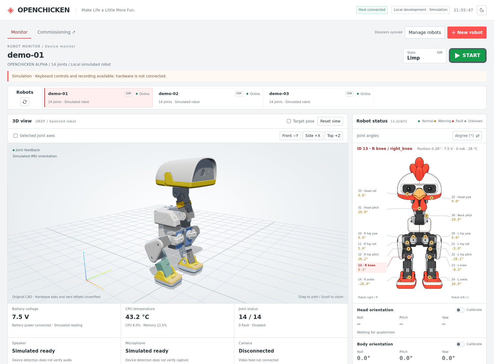
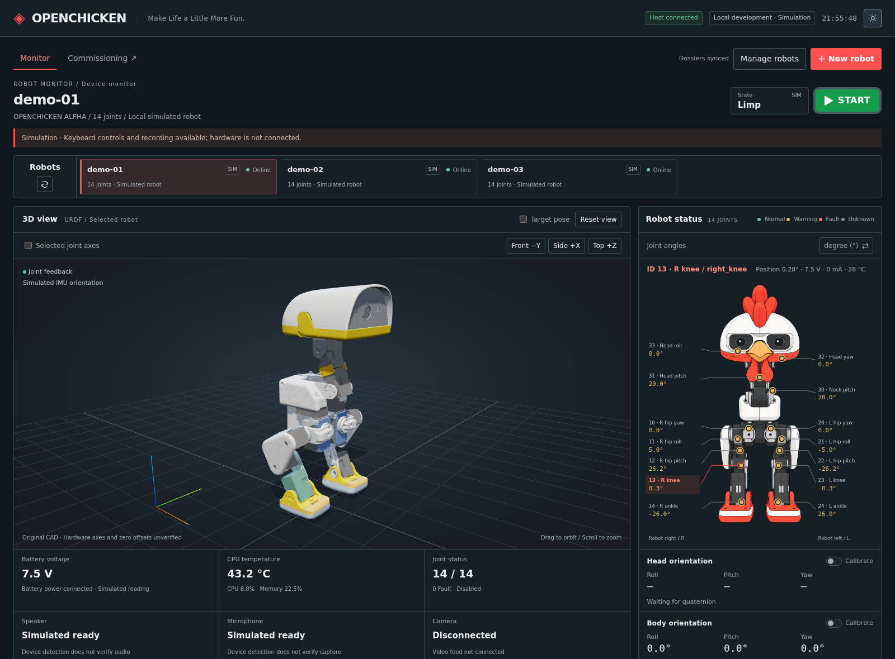

# OpenChicken Console

A monitoring and debugging console for OpenChicken robots, featuring real-time telemetry, URDF 3D visualization, keyboard and Xbox control, and robot commissioning.

**Make Life a Little More Fun.**

OpenChicken 机器人监控与配置测试台。运行监控和新机测试共用机器人档案、三维模型、状态面板和关节曲线，在同一页面通过 Monitor / Commissioning 按钮切换模式。

从 2026-11-02 起，后续监控台开发统一在此仓库进行：

- 仓库：`git@github.com:crown133/openchicken_console.git`
- 本机根目录：`/home/cyz/openchicken/console/openchicken_console`
- 应用源码：本仓库的 `console/` 子目录。保留此层级，部分资源和测试依赖相邻目录。

## 界面预览

截图来自本仓库实际运行的英文页面，使用三台 **模拟机器人**，不是实机遥测；URDF 已实际加载。采集信息见 [screenshots.json](docs/images/screenshots.json)。

### 浅色模式



### 深色模式



## 程序部署、策略与蓝牙配置

配置页新增程序部署、策略与技能、蓝牙手柄、历史与验收。使用方式和当前边界见 [部署与策略管理使用说明](console/integration/监控端部署与策略管理使用说明.md)。

- 程序部署调用本机 deploy 仓库的固定脚本，提供版本列表、状态查询、更新和回退。
- 策略保留 ONNX/JSON 副本、哈希及历史，通过 SSH/SCP 调用原生 robotctl；配置、加载、实物验收分别记录。
- 蓝牙直连通过原生接口配对、查询和解除配对；运行页显示带查询时间的状态快照。
- 运行页显示已加载技能按钮，并使用已发布的键盘/Xbox 绑定；原生蓝牙绑定支持应用和单键恢复默认。

## 快速启动

### 本机默认机器人：openchicken1

本机已迁入原 openchicken1 档案并设为默认，连接 `radxa-zero3`（`192.168.3.182:5557`）。私有配置保存在 Git 忽略的 `console/config/observers/openchicken1.host.json`。状态端口为 5557，控制端口为 5558；两种模式保持状态订阅，仅 Monitor 会话连接所选机器人的控制端口。进入 Monitor 只连接，不自动接管、init 或使能。

```sh
cd /home/cyz/openchicken/console/openchicken_console/console
PYTHONDONTWRITEBYTECODE=1 /home/cyz/miniconda3/envs/LocoMujoco/bin/python -m host.server --port 8106 --demos 0 --robot-config config/observers/openchicken1.host.json
```

使用此命令重启可恢复默认连接；机器人未开机或网络不可达时显示离线。私有配置不随 Git 克隆，其他开发主机需自行配对。SSH 登录信息在机器人档案中管理。

### 同页工作模式

- Monitor / Commissioning 按钮在当前页面切换；保留三维视图、曲线数据和未保存的 N03 表格，不重新打开窗口。旧 `/commissioning/` 地址跳转到统一入口。
- Commissioning 在后端拒绝运动命令。SSH 配置操作沿用现有接口；浏览器手柄和键盘不参与运动控制。
- 当前窗口持有控制权时，切换到 Commissioning 会提示停止并松力，收到结果后再退出控制会话。失败时保留原模式并显示错误。没有控制权时不向机器人发送停止命令。
- 多个窗口共享状态和按需建立的控制连接；一个窗口切换模式不关闭其他 Monitor 窗口使用的连接。最后一个 Monitor 会话退出后关闭真实控制连接。
- 刷新、重连、返回 Monitor 均不会恢复旧输入或自动使能。机器人直连蓝牙手柄是独立控制源，配置模式不代表它已停止。
- 顶栏分别显示机器人在线状态和本窗口的只读/控制连接状态；“Control connected”表示控制传输通道已连接，动作是否成功仍以命令回复和反馈为准。

### 模拟开发：使用已有 Python 环境

在终端执行以下命令，无需重新安装前端依赖：

```sh
cd /home/cyz/openchicken/console/openchicken_console/console
PYTHONDONTWRITEBYTECODE=1 /home/cyz/miniconda3/envs/LocoMujoco/bin/python -m host.server --port 8106 --demos 3
```

服务只监听 `127.0.0.1`。该命令启动三台模拟机器人，不读取旧监控的连接配置、不连接真实机器人。按 `Ctrl+C` 正常退出；退出时可能需要等待已有 WebSocket 连接清理。

| 页面 | 地址 |
|---|---|
| 中文监控 | http://127.0.0.1:8106/ |
| 英文监控 | http://127.0.0.1:8106/en/ |
| 中文新机配置测试 | http://127.0.0.1:8106/?mode=commissioning |
| 英文新机配置测试 | http://127.0.0.1:8106/en/?mode=commissioning |

仅需要空白配置测试台时，将 `--demos 3` 改为 `--demos 0`。端口可用 `--port` 修改；语言由网址区分，页面内不提供语言切换。

### 新开发主机：准备独立环境

推荐 Linux 和 Python 3.10+。在仓库根目录执行：

```sh
python3 -m venv .venv
. .venv/bin/activate
python -m pip install -r requirements.txt
cd console
PYTHONDONTWRITEBYTECODE=1 python -m host.server --port 8106 --demos 3
```

前端是浏览器直接加载的 ES modules，无需 npm 安装或构建。SSH 检查需要监控主机安装 OpenSSH 客户端；当前实现使用 `/usr/bin/ssh`、`/usr/bin/ssh-keyscan` 等 Linux 路径。Node.js、Chrome 和 Playwright 仅在运行相关前端测试时需要。

## 技术栈与数据链路

| 部分 | 实现 |
|---|---|
| 主机服务 | Python，aiohttp 3.11.18：HTTP、WebSocket、档案、录制和配置测试接口 |
| 机器人通信 | Python，pyzmq 27.1.0：ZeroMQ TCP/CURVE 状态订阅和命令通道 |
| 网页 | 原生 JavaScript ES modules、HTML、CSS |
| 三维模型 | Three.js 0.180.0、URDFLoader 0.12.6、本地 URDF/STL |
| 曲线 | uPlot 1.6.32 |
| 实际运动执行 | 独立机器人项目中的 Rust robotd/tofd，本仓库不包含完整运控工程 |

正式接入链路：

```text
机器人：robotd / tofd → Unix socket IPC → Python runtime_agent
                                        ↕ ZeroMQ TCP / CURVE
监控主机：                         Python host.server
                                        ↕ WebSocket
浏览器：                       URDF / 状态 / 曲线 / 输入
```

正式运行时由 robotd/tofd 持有舵机和 IMU 硬件，`runtime_agent` 转发现有 IPC；不要同时启动直接访问相同设备的临时采集器。浏览器显示频率与机器人运控循环频率是不同概念。

## 已有功能

- 中英文独立地址、浅色／深色主题、响应式布局及机器人档案管理。
- URDF 三维关节姿态、机身朝向显示、可点选关节简图；Head/Body orientation 独立显示。
- 关节详情按角度、电压、电流、温度展示；degree/rad 切换同步到关节曲线。
- Requested、Submitted、Feedback 曲线；支持暂停跟随、缩放、拖动及数值查看。Submitted 表示已提交目标，不代表舵机已到达。
- 系统、电源、音频及可用传感器状态；未采集、无效或失联的数据明确显示未知，不用模拟值补齐。
- 键盘／Xbox 输入选择，手柄按键与摇杆状态图；只有选定的输入源参与控制。
- 数据工具中的定格、录制、回放与导出。历史和回放不能当作当前实时状态。
- 新机建档、固定 SSH 只读检查、早期 ZMQ 配对与订阅、分阶段操作指南和人工验收记录。

三维显示依据当前已接入的关节和机身姿态更新，位置固定；头部 IMU 数字显示不直接驱动头部 URDF。示意图标记和显示零位不替代机械标定。视图可用不代表实机动作已验收。

## 控制输入

Start 对应 `init`，E-stop 对应 `relax`，为同一个随状态改变的按钮。初始化与策略使能分开；Start 不自动启用行走策略。E-stop 是软件松力命令，不等于独立硬件急停回路。

| 输入 | 含义 |
|---|---|
| 键盘 W/S | 前进／后退 |
| 键盘 A/D | 左转／右转 |
| Space | 停止行走；不等同于关闭力矩 |
| Esc | 释放当前控制 |
| Xbox 左摇杆 | vx / vy，映射范围 ±0.4 / ±0.3 m/s |
| Xbox 右摇杆左右 | 偏航角速度，映射范围 ±1.0 rad/s |
| Xbox Start | init |
| Xbox LB+B | relax |
| Xbox LB+A | 坐下／站起切换 |
| Xbox LB+X / LB+Y | 左踢／右踢 |

手柄接在运行浏览器的主机上，需支持标准 Gamepad 布局。切换到 Xbox 输入后使用；输入图高亮仅说明检测到按键，不代表机器人执行成功。可用动作取决于当前连接能力和机器人状态。

浏览器失焦、断连及输入循环长时间阻塞会清理输入／释放控制。当前正式 ZMQ→IPC 链路仍沿用原 RPC 接收语义，不能宣称已具备完整的跨主机命令到期保证，也不能通过延长机器人超时掩盖渲染卡顿。

## 实机接入

源码仓库不包含原 `console/config/` 中的机器人档案、私钥或 SSH 信任记录。新仓库启动不会自动复用旧连接。

### 新机早期只读状态

1. 在 `/commissioning/` 建档，填写实际 IP、SSH 用户、robot_id 和端口。
2. 在 SSH 区域获取并核对主机指纹；用户名＋密码认证用于固定检查任务，N01 可读取实际 hostname。SSH 检查为一次性快照，不持续驱动模型和曲线。
3. 在“早期 ZMQ 状态连接”选择协议、准备主机配置；展开页面生成的配对和启动步骤。
4. 机器人端具备对应 Python 采集代码和依赖后，按说明生成独立密钥、交换公钥并启动匹配的发布器；页面不自动部署代码。
5. 点击“连接状态反馈”，确认有效帧和数据来源。系统采集器只提供系统状态，关节／IMU 需对应采集版本和硬件所有权条件。

主机订阅断开不会停止机器人采集进程。转入正式服务前，需要退出临时采集器并确认硬件释放。

### 已有正式 runtime 服务

在 `console/` 目录中，使用已审阅的 **host 配置**启动：

```sh
PYTHONDONTWRITEBYTECODE=1 python -m host.server \
  --robot-config config/robot.host.json --port 8106 --demos 0
```

这是配置文件路径示例，需要先准备实际文件。配置包含 `role=host`、`protocol=openchicken-runtime-v1`、相同的 `robot_id`／实际 `hostname`、机器人状态 `endpoint`、本机 CURVE `public_key`／`secret_key` 及机器人 `peer_public_key`。

状态端口通常为 5557，命令端口通常为 5558，以实际部署为准。**省略 `control_endpoint` 只订阅状态；配置命令端口后才具备对应控制通道。** 建档或页面跳转不会自动把只读连接升级为运控连接。不要在 README、提交或验收记录中保存私钥和密码。

正式 IPC、服务分工及历史部署约定见[接入说明](console/integration/2026-10-28-deploy-plan.md)；其中机器人发布路径和外部证据需要按实际机器核对。

## 配置测试工作台

| 阶段 | 内容 |
|---|---|
| N01 | 新机建档、系统身份、基础 SSH 与早期状态连接 |
| N02 | UART/I²C、音频驱动、重启复查 |
| N03 | 舵机通信与 ID、参数差异、方向与机械零位 |
| N04 | 扬声器／麦克风、双 IMU、电压与供电检测 |
| N05 | 正式服务与 IPC、双端连接、真实遥测 |
| N06 | Runtime／模型版本、隔离推理、观测来源与顺序 |
| N07 | 控制台回位、Ready 与实际松力确认 |
| N08 | 控制台基础策略闭环 |
| N09 | 控制台移动与动作 |
| N10 | 配置固化、重启和交付记录 |

N02～N06 的 15 个子项有具体命令、前置条件、预期输出、收尾说明及复制按钮。**复制不会执行**；工具目录、模型和 Runtime 路径需填写机器人上的实际值。通用舵机参数写入工具和未部署检查器的缺口已明确标注，不能把未执行项目标为通过。

SSH 面板执行的固定检查仅覆盖 N01 系统、N02 接口元数据、N04 音频枚举、N05 服务与 IPC 路径。音频枚举不等于实际播放／录音通过；其余项目按说明执行和人工记录。N07～N09 提供运行监控跳转入口，不自动发送动作。

## 目录与数据

```text
console/
  host/          主机服务、连接、录制、档案、SSH 和测试接口
  agent/         模拟器、正式 IPC 桥接、早期采集器
  protocol/      协议、关节映射和校验
  web/src/       页面、状态图、模型视图、曲线、键盘/Xbox 输入
  web/vendor/    固定版本前端依赖及许可证、来源记录
  models/        URDF、网格、模型来源
  tests/         Python 和 JavaScript 测试
  tools/         模型生成及历史诊断工具
  integration/   接入说明和历史差异
  config/        本机私有配置与档案（运行时生成，Git 忽略）
docs/testing/    标准测试流程与记录模板
docs/images/     README 实际界面截图
artifacts/       本机录制等运行产物（Git 忽略）
requirements.txt
```

默认档案位于 `console/config/robots.json`，可通过 `--registry` 指定其他文件。SSH 信任／结果和早期遥测配置位于注册表同级 `commissioning/` 下。默认录制目录为仓库根目录的 `artifacts/console-recordings/`。

根目录 `openchicken_deploy/` **仅含测试需要的少量参考文件**，不是完整 Rust 工程。`robots/` 中的一份舵机审计文件和 `console/agent/imu_calibration.json` 是历史测试基线，不能直接作为新机器的实时状态或标定。

## 开发与验证

在仓库根目录、已准备的 Python 环境中运行后端测试：

```sh
PYTHONDONTWRITEBYTECODE=1 PYTHONPATH=console python -m unittest discover -s console/tests -v
```

本机已有环境可将 `python` 换成 `/home/cyz/miniconda3/envs/LocoMujoco/bin/python`。测试使用本地 socket 和替身硬件；深层长路径可能触及 Unix socket 长度上限，必要时使用较短的独立测试副本。

不依赖浏览器的前端逻辑检查示例：

```sh
node console/tests/attitude.mjs
node console/tests/gamepad.mjs
node console/tests/view-pose.mjs
```

浏览器测试位于 `console/tests/browser*`，需要 Chrome、Playwright 和测试服务。不同历史脚本的地址、截图输出、外部参考数据及路径参数不完全相同，运行前检查脚本头部；不要指向正在实机操控的服务。

导出时验证记录见 [EXPORT-VALIDATION.json](EXPORT-VALIDATION.json)：100 项后端测试首轮 99 项通过，1 项模拟 IPC 非阻塞发送报错，单独复测通过。此记录不是完整实机验收。README 截图另验证了新仓库模拟服务、实际 URDF 加载和深浅色页面，没有发送控制命令。

修改页面、协议或主机逻辑后，按改动运行相应检查。涉及电机控制、硬件所有权、watchdog、部署或生产启动入口的改动，应先审阅差异，再按已授权范围实施。不要将私有配置或运行数据提交到 Git。

## 开发记录与来源

- [工作区约定](DEVELOPMENT.md)
- [策略包、动作绑定与蓝牙直连手柄方案（V4.1，设计参考）](console/integration/策略包与动作绑定接口方案.md)
- [策略包 JSON 示例](console/integration/examples/policy-package.example.json)
- [历史开发记录](console/README.md)：保留原文，旧阶段描述不代表当前实现或放行状态。
- [新机标准部署与测试流程](docs/testing/新机标准部署与测试流程.md)
- [标准配置与测试流程](docs/testing/标准配置与测试流程.md)
- [分阶段实机测试计划](docs/testing/控制台分阶段实机测试计划.md)
- [新机器人验收记录模板](docs/testing/新机器人验收记录模板.md)
- [导出文件范围](EXPORT-MANIFEST.json)

历史文档指向原工作区 `artifacts/`、完整机器人工程等路径时，对应材料可能不在本仓库。`FILES.sha256` 记录最初导入的导出快照；后续版本以 Git 为准，正常开发修改不再保证匹配原快照哈希。

第三方代码和模型保留各自许可证及来源声明，见 `console/web/vendor/`、`console/models/` 及参考源码许可证。本仓库未另行声明覆盖全部内容的统一许可证。
