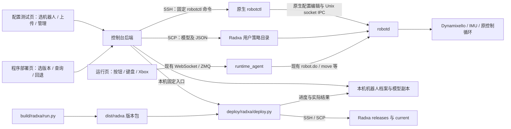

# 程序部署、策略管理、动作绑定与机器人档案方案

2026-11-03，V5 设计稿，实施状态已更新：程序部署接入、策略档案与基础原生管理、蓝牙配对/状态管理已落地并经过本地模拟测试；测试前修订补充了部署版本与验收关联、槽位校验、JSON 预填及独立 padd 配置核验。动态输入和原生按键写入仍为待审阅补丁，phase/posture_flag 专用槽位因缺少原生有效时序证据暂不允许应用，实机验收未执行。实际入口和限制以[监控端部署与策略管理使用说明](监控端部署与策略管理使用说明.md)为准。下文保留目标设计，不表示每个目标均已验收。

详细子方案：[本地部署仓库编译打包与监控端部署方案](本地部署仓库编译打包与监控端部署方案.md)。本文统一页面、职责、档案及实施依赖；构建包格式、发布切换与回退以该子方案为准。这里的“固件”是 Radxa 应用部署包，不涉及系统镜像或舵机刷写。

## 1 结论与范围

在监控台“配置测试 → 机器人档案”中增加“策略与技能”页。选择机器人后，上传 ONNX 和可选 JSON，新增/修改技能、替换策略槽、配置触发按键、查询加载结果，以及移除或恢复旧版本。所有增删改操作、模型版本、绑定和验收结果归入该机器档案。另在输入绑定区域增加“机器人蓝牙直连手柄”管理，由监控主机通过 SSH 调用机器人原生 CLI；不是管理监控电脑本机蓝牙。

策略与手柄管理模块修改控制台主机后端及前端，复用原生 CLI、持久配置和运行时；蓝牙配对入口复用已部署的 configd、BlueZ 和 padd 能力，不因配对操作自动安装或启用服务。**策略管理本身不新增 robotd、runtime_agent、ZMQ 协议、硬件读取或控制循环改造，不增加板端常驻管理进程。** 程序部署模块可通过用户选定的完整发布包更新现有原生程序和监控桥接代码；这与策略增删、配对操作分开执行。首次服务安装或启用属于明确的初始化操作。 `robotctl` 是命令行客户端；常驻运控程序是 `robotd`，每次配置操作不启动新的 robotd。

实施范围按当前 CLI 能力收敛：兼容当前 61 观测、14 动作、50 Hz 合同的普通技能和原有策略槽；JSON 用于预填参数和描述模型，不作为通用执行脚本。原 CLI 没有提供的参数不假装已生效，详见第 4 节。

新增“程序部署”页，管理 Radxa 应用发布版本；“策略与技能”页继续管理独立 ONNX/JSON、策略参数和绑定。两者共用所选机器人和稳定 profile_id，互不隐式触发部署或恢复。部署包不包含该机器的私有配置、Homing Offset、用户策略或凭据。

## 2 调用链与职责



- **配置测试页**：程序版本选择、策略表单、文件预览、操作进度、加载证据和档案历史。
- **主机后端**：策略模块解析 JSON、保管模型副本、SCP 上传并通过 SSH 执行固定 robotctl 命令；程序模块只调用本地 deploy 仓库脚本、读取事件与结果并写档案，不另写上传/切换 current/管理服务的部署实现。SSH 凭据复用现有会话处理。
- **deploy 仓库**：拥有编译、打包、版本列表、SSH/SCP 部署、服务切换、状态查询和恢复脚本，终端与页面使用同一入口。
- **robotctl / robotd**：按原生流程写配置、请求重载、加载模型和处理技能。监控端不再实现一份技能切换状态机。
- **运行页 / agent**：保持现有运动控制权、Start → Ready → 策略使能、停止/relax 和输入时效处理；新增动作只需传技能名。

配置管理不要求 ZMQ 在线；读写配置及加载确认仍分别取决于 SSH 和 robotd 是否可用。试运行必须连接原控制链路。上传、保存表单、切换档案不触发运动。原生加载正在使用的策略可能产生回位行为，因此应用替换沿用现有停止/relax 操作，在未使能时进行，不由上传流程自动停止或重新使能机器人。

## 3 页面组织

配置测试保留现有顶栏、机器人选择和直观测试视图。在同一机器人档案下提供“程序部署”和“策略与技能”两个模块，不另做独立部署平台。

“程序部署”显示主机 deploy 仓库路径、机器人实际运行版本和可用版本表，提供“刷新版本、部署所选版本、查询当前版本、恢复上一版”；部署前展示目标、版本及服务更新范围，执行中展示脚本日志与结果。第一版不提供页面编译按钮，后续按钮复用同一构建脚本。详细流程见第 12 节。

“策略与技能”继续使用以下四个区域：

| 区域 | 显示与操作 |
| --- | --- |
| 策略槽 | walk、stand、sitstand、ground_pick、kick_left、kick_right、roulade 的实际路径、配置路径、加载错误；上传替换、恢复历史版本、恢复原生默认 |
| 自定义技能 | 名称、模型版本、持续时间、运行/退出命令、退出时间；新增、修改、移除定义 |
| 输入绑定与直连手柄 | 页面按钮、键盘、浏览器 Xbox；机器人蓝牙直连手柄的配对、连接状态、解除配对及原生按钮绑定 |
| 历史与验收 | 上传/新增/修改/移除/恢复/绑定变更及配对/解除配对记录，配置及加载结果，人工动作结果 |

首次打开显示档案缓存及“上次同步时间”，点“读取机器人”获得当前结果。离线仍可查看历史、导入模型和保存草稿；不把这些显示为机器人部署成功。模型导入后先预览目标槽/技能、参数及绑定，再显式应用。

删除按钮区分“移除自定义技能”“移除内置覆盖”“停用可选槽”，不能用一个“删除策略”隐藏不同原生行为。模型文件不随移除定义自动删除；第一版保留历史文件，不增加清理功能。

动作试运行入口跳转到该机器现有运行页，并定位相应动作按钮。无需再创建配置页专用运动通道。原有 N01–N10 测试记录保留，新策略验收关联这些记录或保存独立结果，不改写此前的硬件验收。

## 4 原生接口如何通过 CLI 落地

### 4.1 实机路径

下面是既有 openchicken1 部署记录的路径，实施时先只读核对；不是对当前在线状态的声明。

| 档案部署字段 | 当前路径 |
| --- | --- |
| `robotctl_path` | `/home/openchicken1/openchicken_deploy/current/bin/robotctl` |
| `robot_socket` | `/run/robotd/robotd.sock` |
| `config_path` | `/home/openchicken1/openchicken_deploy/config/robotd.toml` |
| `config_socket`（新增档案字段） | 配对/状态/解除配对使用的 configd socket；源码默认 `/run/configd.sock`，先核对实际部署 |
| `pad_config_path`（新增档案字段） | 原生直连手柄绑定使用的配置文件，核对 padd 实际加载路径，不假定与 robotd.toml 相同 |
| `policy_root`（拟新增） | `/home/openchicken1/openchicken_deploy/policies/custom` |

路径作为该机器人档案的部署设置保存，不根据可修改的机器人显示名或 IP 拼装。策略和绑定命令显式指定 `--robot-socket`；蓝牙配对/状态/解除配对显式指定 `--config-socket`，不是 `--pad-socket`（后者用于读取 padd 输入流）。策略配置使用 `policy --file`，机器人直连手柄配置使用全局 `--pad-config`。这些参数必须指向运行中服务实际使用的配置，避免误写 CLI 默认的 `/etc/robot/robotd.toml`。

### 4.2 操作对照

下表省略固定的 robotctl 绝对路径、socket 和配置路径前缀；是方案说明，不是本轮执行记录。

| 用户要求的原生能力 | SSH 内执行的 CLI | 说明 |
| --- | --- | --- |
| `robot.policies` / `robot.skills` | `policy --file <config> list --json` | 一次返回 policies 与 skills；用于显示槽和技能定义 |
| `robot.setSkill` 新增/修改 | `policy --file <config> add <name> <absolute-model-path> --hold <seconds> --command <x,y,z> --unwind <seconds> --unwind-command <x,y,z>` | CLI 直接编辑配置，再请求 robotd 重载；达到管理目的，但不是逐字段封装 setSkill RPC |
| `robot.removeSkill` | `policy --file <config> remove <name>` | 移除配置覆盖并请求重载；不删除模型文件 |
| `robot.loadPolicy` | `policy --file <config> load <slot> <absolute-model-path> --json` | 复用原生持久化和加载流程 |
| 恢复原生默认 | `policy --file <config> reset <slot> --json` | 恢复原生默认路径，不等于恢复我们上一版模型 |
| `pad.bind` / 查询 | `--pad-config <config> pad bind <button> <skill> --json`；`pad bindings --json` | 仅影响机器人直连 padd；查询也使用同一全局配置参数 |
| 直连手柄连接状态 | `--config-socket <socket> pad status --json` | 查询 configd；分别报告 pads 与 padd driver 状态 |
| 蓝牙配对 | `--config-socket <socket> pad pair [<MAC>] --timeout <seconds> --json` | 用户显式启动；解析 outcome，随后刷新状态 |
| 解除配对 | `--config-socket <socket> pad forget <MAC> --json` | 删除机器人侧 bond；解析 removed，随后刷新状态，不等同于删除动作绑定 |
| `robot.do` | 原生有 `robot do <skill>`，监控台试运行继续使用已有 action 消息 | 避免另建 SSH 运动入口；不改原生 CLI |

完整的只读查询示例：

```sh
/home/openchicken1/openchicken_deploy/current/bin/robotctl \
  --robot-socket /run/robotd/robotd.sock \
  policy --file /home/openchicken1/openchicken_deploy/config/robotd.toml list --json
```

### 4.3 当前 CLI 的真实限制

1. **本地 ONNX 不会自动读取旁边的 JSON。** 控制台解析 JSON 后把 duration、command、unwind 等转换成 CLI 参数。复制两个文件不代表 manifest 已被运行时执行。
2. **`policy add/remove --json` 当前不请求重载。** 第一版使用不带 `--json` 的 add/remove，保存终端输出，再用 `list --json` 查询；不为此修改板端程序。
3. **本地文件模式不能通过 add 设置 chain、action_scale、gain_ratio。** 当前 CLI 没有这些选项，本地 add 会使用其默认/继承行为，也可能覆盖旧定义中的自定义值。第一版仅管理能由 CLI 完整表达的定义；导入要求自定义这些参数，或编辑已有此类覆盖时，明确列出不支持字段，不静默丢弃。表单可显示实际值，但不提供虚假的可编辑控件。
4. `report_reload` 的拒绝/失败信息可能只打印在输出中，进程退出码为 0 不能单独作为加载成功证据。
5. skills 查询主要给出磁盘定义，policies 的已加载技能列表主要给出名称。同名技能修改后，仅名称存在不能证明新文件已切入。槽位按实际路径和 error 确认；技能结合配置、重载输出、查询及可读的本次原生日志，证据不足时显示“已配置，实际版本待确认”。不为解决显示问题而扩展 IPC。
6. `remove` 删除内置技能的覆盖后，内置定义可能重新出现；可选槽可用原生 `none` 停用，walk 不支持停用。原生 reset 的默认目录在定制部署中必须存在，恢复历史版本优先使用档案中的旧绝对路径。

因此，本方案能实现常用策略管理，但不能声称现有 CLI 完整覆盖 `robot.setSkill` 所有字段。未来确实需要高级覆盖时，再单独讨论补齐 CLI 参数；本轮方案不预先修改部署端，也不直接改 TOML 绕开此边界。

## 5 ONNX + JSON 输入约定

支持“上传 ONNX 后填表”和“ONNX + JSON 预填表”两种入口，结果相同。沿用 [MicroDuck manifest schema 2](../../openchicken_deploy/docs/policy-manifest.md)，项目扩展放入 `openchicken`。不要求压缩包；第一版 ONNX 应自包含权重。

示例见 [policy-package.example.json](examples/policy-package.example.json)。示例未附模型，参数不是任何新动作的验收结论。

| JSON 字段 | 第一版用途 |
| --- | --- |
| name、description、package_version、label | 技能名、版本、界面名称和档案信息 |
| file、model_api、obs_len、action_len | 模型及接口声明；加载结果仍以板端为准 |
| kind、duration_s、unwind_s、command | 普通技能运行/结束语义；支持的值转为 CLI 参数 |
| execution.command | 运行窗口内的三维命令，映射 `--command` |
| command.idle | 退出窗口命令，映射 `--unwind-command` |
| observations、actions、runtime_profile | 描述输入输出语义及顺序，用于兼容性对照，不是动态观测解释器 |
| runtime_tuning | 对照已有全局滤波/电压适配等；导入不修改全局设置 |
| bindings | 预填页面、键盘、浏览器手柄及可选直连手柄绑定 |

未支持的运行语义不能仅存进档案就标为“已应用”。`chain=false` 可表达当前本地 add 行为；自定义倍率和 gain_ratio 不在第一版可写范围，示例省略它们。若模型需要这些参数，应先解决 CLI 能力，不用默认值代替。

普通技能主要接受 constant command 的 episodic 模型；有退出阶段的模型需要明确 hold/unwind 参数。phase/posture_flag 模型走原 sitstand/ground_pick 专用槽。`loadPolicy` 替换 ONNX 不会自动采用旁置 JSON 的新 phase、ramp、rise 等时序；槽替换必须与当前槽的有效语义匹配。

当前固定合同如下：

| 观测区间（左闭右开） | 含义 |
| --- | --- |
| [0,3) | body 角速度，rad/s |
| [3,6) | body 坐标投影重力，单位向量 |
| [6,20) | 14 关节位置减 home，rad |
| [20,34) | 14 关节速度，rad/s |
| [34,48) | 上一轮 14 维原始网络动作 |
| [48,61) | twist 3 + 头部命令 4 + body 命令 6 |

14 输出顺序为左腿五关节 → 颈俯仰、头俯仰、头偏航、头侧倾 → 右腿五关节。动作按原运行时转换为 home 周围的位置偏移，再经过已有尺度、电压适配和滤波。使用已有运控观测，不将监控遥测回灌推理，不重复 IMU 坐标变换，不由策略包改 ID 或 Homing Offset。

相同维度也不保证兼容：顺序、单位、归一化、command 编码都要一致。新增输入、历史堆叠、任意关节重排、力矩输出或不同周期仍需 Runtime 适配。源码已有 LSTM 支持不等于固化的板端版本具备相同能力；实施时通过版本及原生能力报告核对。`model_api` 与 IPC API47 不是同一版本号。

## 6 按钮、键盘与手柄绑定

所有绑定以技能名为目标，保存到所选机器人档案。页面按已应用绑定生成动作按钮，动作消息仍使用当前通用 action 转发，不为每个技能改 agent。

| 输入 | 存储和生效位置 |
| --- | --- |
| 页面动作按钮 | 档案保存名称/排序；运行页按机器人加载 |
| 键盘 | 档案保存 KeyboardEvent.code；运行页使用 |
| 浏览器 Xbox | 档案保存标准按钮/组合键；浏览器 Gamepad API 使用 |
| 机器人直连手柄 | 通过 robotctl pad bind 写板端原配置；档案保存请求值及读取值 |

当前 Xbox 连接监控电脑，经过浏览器 → WS → ZMQ → agent → robotd，不经过 padd。`pad.bind` 无法改变浏览器 Xbox 绑定；直连 padd 通常使用蓝牙，新增配对/连接状态/解除配对入口通过 SSH 调用原生命令（见 6.1）；服务部署或启用不由本功能自动完成。V4 的 A/B/X/Y/LB/RB 原生绑定列表属于旧版本描述；当前统一约定采用 lb_a、lb_down、lb_left、lb_right、lb_up，实施时读取目标 CLI 能力并核对版本。LB+B、Start/Select 长按、模式选择和死区遵守已确认的统一映射，不通过普通技能绑定覆盖；旧版本不支持时提示先通过程序部署升级，不静默回退到旧按键习惯。

第一版新增技能按下沿触发一次，忽略键盘自动重复；已有动作的行为保留。不为 CLI 不支持的 chain 参数新增通用长按模式。停止、relax、基础移动轴及现有急停键保持既有行为。输入框或配置页不触发运动；绑定冲突在应用预览中列出，用户选择替换或换键。

绑定仅在对应模型的应用结果符合条件后发布给运行页；实际加载未确认时保留原绑定并显示待确认，不将新按钮显示为已验证可用。失败或移除后停止发布失效绑定。内置覆盖移除后若恢复同名内置动作，明确显示绑定现在指向原生默认版本。

### 6.1 机器人蓝牙直连手柄管理

“输入绑定”区域内增加直连手柄卡片，与“浏览器 Xbox”明确分开。第一版提供三个入口：**配对、刷新连接状态、解除配对**，不新增任意蓝牙终端、服务启停或独立连接/断开命令。

| 入口 | 操作说明与结果 |
| --- | --- |
| 配对 | 提示先使手柄进入配对模式；Xbox 为短按 Xbox 开机，再按顶部 Sync 直至快速闪烁。默认按原生发现流程寻找手柄，可指定 MAC 消除多设备歧义；用户显式提交后才执行 |
| 连接状态 | `pad status --json` 读取设备名称、MAC、paired、trusted、connected 和独立的 driver 状态，显示读取时间；未读取/超时为未知，缓存不能显示为实时在线 |
| 解除配对 | 在已读取的设备行选择 MAC，预览目标后执行 `pad forget`；只删除机器人侧配对关系，手柄自身仍保留旧 bond，下次需重新进入配对模式 |

配对后的自动重连沿用原生 BlueZ 信任机制。配对成功不等于当前已连接，已连接也不等于 padd 正在运行，更不等于动作验收通过。driver 按原生值显示 active/inactive/restarting/failed/absent/unknown；查询失败不能误显示为“没有手柄”。不伪造原生接口没有提供的电量、信号强度或实时按键。

以档案内 robotctl 绝对路径和已核实的 config_socket 构造固定命令：

```text
<robotctl_path> --config-socket <config_socket> pad status --json
<robotctl_path> --config-socket <config_socket> pad pair --timeout 30 --json
<robotctl_path> --config-socket <config_socket> pad pair <MAC> --timeout 30 --json
<robotctl_path> --config-socket <config_socket> pad forget <MAC> --json
```

以上为方案命令模板，不是已执行记录。MAC、超时使用结构化字段校验和远端 shell 正确引用；不接收整条命令。首次先只读核对板端 CLI、configd socket/访问权限和蓝牙/padd 状态。既有 openchicken1 记录仅确认 robotd、tofd、agent 三个服务，不据此推断 configd 或 padd 已安装启用；缺失时明确显示功能未就绪，另行处理原生服务部署，不自动修改系统配置或启用 padd。

结果按原生 JSON 解释：`pair` 只有 `outcome=paired` 才代表配对成功；`outcome=failed` 时显示 not_found、ambiguous、timeout、no_adapter、rejected 或 other 及 detail，不能以 CLI 退出码 0 判成功。ambiguous 时显示原生可提供的信息并让用户指定 MAC，不自动选择任意手柄。`forget` 的 `removed=false` 表示目标原本未配对，是幂等结果，不假报删除失败。每次变更后再读 status；若变更已完成但查询失败，分别记录操作结果与“当前状态待确认”。

配对/解除配对属于有副作用的配置操作：本地源码的 `pad pair` 在特定板端标记下可能临时暂停 btd 并重置蓝牙适配器，正常返回时按原生清理逻辑恢复。页面预览需说明可能影响已有蓝牙连接；SSH 断开或进程中止后不能保证恢复完成，先重新核对状态，不自动重试。监控端不额外执行 bluetoothctl、重启服务或修改蓝牙配置。

操作前由用户通过既有流程停止运动并松力、保持手柄回中；配对后若 padd 已运行，会直接接收手柄输入，不能声称页面未发 action 就完全没有运动风险。机器人直连 padd 不受浏览器 Keyboard/Xbox 选择和浏览器控制权约束，应避免两路同时操控。页面不自动 init、enable 或切换控制来源，也不新增板端控制锁。

任务复用同一 SSH 信任与临时凭据机制，后台异步执行，配对超时应覆盖原生扫描窗口并留清理时间；不会阻塞 WebSocket 停止/relax。对同一机器人，配对/解除配对与策略修改任务串行，避免同时重载或切换输入环境。浏览器断开、SSH 超时或服务重启后的不确定结果记为待核对，重新读取后再由用户决定；不补发配对或解除配对。

状态和操作仍按 profile_id 归档。档案保存设备名称/MAC、最近状态、读取时间、操作请求与结果、前后快照及错误；不保存或导出 BlueZ 配对密钥。解除配对不删除技能/策略版本/按钮映射；恢复策略历史也不重新配对手柄。向新机器人复制模板不继承“已配对/已连接”状态，删除档案不隐式解除机器人配对。

### 6.2 板端原生链路与配置前提

配对链路：`robotctl pad pair → configd → 系统蓝牙 BlueZ`。
配对后的控制链路：`手柄 → Linux 输入设备 → padd → robotd`。此链路不经过浏览器或监控主机 ZMQ，不受页面输入源开关控制。

| 项目 | 配置要求 |
| --- | --- |
| 系统蓝牙 | Radxa 蓝牙适配器正常，BlueZ 可用；缺失时报告原生 no_adapter 等结果 |
| configd | 启用原生配置服务，提供 `/run/configd.sock` 配对接口，核实实际监听路径 |
| 配对权限 | SSH 用户具有 socket 访问权限，并由 configd 的 `--allow-user openchicken1` 授权；其他机器人使用各自实际用户名 |
| padd 程序与配置 | 使用 `/home/openchicken1/openchicken_deploy/current/bin/padd`，通过 `--config /home/openchicken1/openchicken_deploy/config/robotd.toml` 读取现有配置 |
| 运控连接 | padd 显式指定 `--socket /run/robotd/robotd.sock` |
| 输入权限 | padd 运行用户能读取对应 `/dev/input/event*`，按实际用户、组和设备权限核对 |
| 连接方式 | 现有 robotd.toml 中 `[netpad] enabled = false`，使用本机手柄；不能只看蓝牙连接成功就忽略当前输入模式 |

`--allow-user` 是 configd 的原生修改权限，不只允许手柄配对；socket 文件权限与 configd 内部授权都要满足。服务程序路径、运行用户和参数必须适配当前 `/home/openchicken1/...` 部署，不能直接安装使用 `/opt/robot/...` 的原版 service。以上是待核对/补齐的配置，不是已部署事实。本方案不修改 configd/padd 源码；服务配置、用户权限及 netpad 设置变更需先给出针对当前部署的差异，再按授权实施，不由打开配置页或点击查询自动完成。

配置完成后，人工 SSH 使用下列原生命令；页面后端使用相同命令的 `--json` 输出：

```sh
robotctl_bin=/home/openchicken1/openchicken_deploy/current/bin/robotctl

# Xbox 开机后按顶部 Sync 键，直到指示灯快速闪烁
"$robotctl_bin" --config-socket /run/configd.sock pad pair --timeout 30

# 查询配对、信任、连接及 padd 状态
"$robotctl_bin" --config-socket /run/configd.sock pad status

# 将示例 MAC 替换为状态列表中实际选中的手柄地址
"$robotctl_bin" --config-socket /run/configd.sock pad forget 'AA:BB:CC:DD:EE:FF'
```

配对成功会按原生流程建立信任，支持后续重连；后续是否实际连接仍通过 status 判断。示例 MAC 仅用于说明，不是设备默认值。

### 6.3 配置页结果反馈与运行页连接状态

**配置测试页必须反馈每次操作结果。** 点击配对后立即显示任务已提交/配对中，返回 operation_id；异步任务完成后，同一任务卡显示成功、原生失败或结果待核对，并附错误原因、设备信息和完成时间。页面关闭后重新打开仍能查看此任务，不能只留一个短暂 toast。

| 情况 | 配置页反馈 |
| --- | --- |
| `outcome=paired` | “配对成功”，显示原生返回的设备名称/MAC/信任状态；随后在本次认证任务内复查 status |
| `outcome=failed` | “配对失败”，显示原生 reason/detail，例如未发现、多个设备、无适配器或被拒绝；不自动重试 |
| SSH 认证/授权失败，明确未执行 | 显示对应认证、socket 访问或 configd 授权错误，不冒充蓝牙配对失败 |
| 命令已发出后 SSH 超时/中断，无法确认结果 | “结果待核对”，保留原始错误；下次先读 status，不自动重发 pair/forget |
| 操作已确认成功，但随后 status 查询失败 | 保留“配对/解除配对成功”的操作记录；当前连接状态单独显示未知 |
| 解除配对 | 分别显示 removed=true 的解除成功、removed=false 的原本未配对，并刷新当前状态 |

**运行监控页也显示机器人侧蓝牙手柄状态。** 在 Robot controls 顶部增加紧凑“机器人直连手柄 / Robot Bluetooth pad”状态卡，按当前所选 profile_id 展示，与浏览器 Xbox 连接状态分开；不随 Keyboard/Xbox 选择被隐藏。多个已配对设备逐项展示，不能任意指定某台为正在操控者。

| 显示 | 判定依据 |
| --- | --- |
| 已连接 / Connected | 最近一次有效原生 status 中对应设备 connected=true；同时显示 paired/trusted 和独立的 padd 状态 |
| 已配对，未连接 / Paired · disconnected | 有 paired=true 的设备，但 connected=false |
| 无已配对手柄 / No paired controller | 成功读取原生 status，pads 为空或没有 paired=true；不能由 SSH 失败推断 |
| 状态未知／待刷新 / Unknown · refresh needed | 从未查询、查询失败、目标身份变化或只有历史缓存；保留“上次读取时间”和历史值标签 |

“已连接但 padd 未运行”明确组合显示，不简化成“可控制”。连接状态和策略使能、运动能力、动作验收分别呈现；不因配对成功自动改变运行页控制权限。

配置页与运行页共用主机档案中的 `direct_pad` 最近结果和任务记录，不新增 agent/ZMQ 遥测字段。第一版提供显式“刷新状态”和配对/解除配对后的自动复查，状态均标明“SSH 查询 · 时间”，不是连续实时遥测。进入运行页只读取本机缓存，不自动索取密码或发起配对；刷新复用已有 SSH 信任核对和按次凭据机制，密码不落盘。尚无有效凭据时提示先完成 SSH 查询，不能假设现有单次密码检查已具备长期认证会话。仅有缓存、主机重启或刷新失败时，不持续显示绿色实时在线。若后续需要后台定时刷新，应另行明确认证会话的生命周期，本版不以保存明文密码实现。

同一机器人配对期间避免并发发起状态扫描；任务结束后读回一次即可。运行页可通过本机 HTTP 获取最新状态和进度，不触发机器人动作，不让 SSH 操作阻塞已有控制消息。

## 7 机器人档案：保存什么、存在哪里

### 7.1 以档案稳定 ID 关联

使用现有 `RobotRegistry` 中的 `row.id` 作为 `profile_id`，不使用 IP、显示名或可修改的 robot_id 作为存储主键。每台机器人独立保存部署路径、程序发布、策略版本、当前引用、按键绑定及历史。主机 deploy 仓库路径属于监控主机设置，多台机器人共用，不放进每台机器的策略参数。

保留现有 JSON 档案存储，在机器人行下增加 `policy_management` 字段，包含以下内容。通过专用后端更新，基础档案编辑继续只接收原字段，不能把整个策略对象随表单覆盖。

| 内容 | 记录项 |
| --- | --- |
| 部署环境 | robotctl/robot_socket/config_path/policy_root/config_socket/pad_config_path，最近读取的软件版本及目标地址 |
| 模型版本 `versions` | version_id、技能/槽、包版本、原文件名、大小、SHA256、本机副本及板端绝对路径、解析后 manifest |
| 当前状态 `entries` | 目标类型/名称、期望版本、最近读到的配置、实际加载证据和时间、active/removed 状态 |
| 输入 `bindings` | 已发布的页面/键盘/浏览器绑定、待应用绑定、直连手柄最近读取值 |
| 直连手柄 `direct_pad` | 最近原生 status、设备名称/MAC、paired/trusted/connected、driver、读取时间和目标；配对密钥不入档案 |
| 操作 `operations` | operation_id、动作、时间、目标、变更前后值、配置结果、加载结果、输出/错误及文件引用 |
| 验收 `tests` | 关联版本、未测/通过/失败/跳过、人员说明、时间、现有测试记录引用 |

不同阶段分别记录：`config_result`（是否落盘）、`load_result`（确认/失败/未知）、`motion_test`（未测/通过/失败/跳过）。上传成功不等于配置完成，配置完成不等于新模型已加载，加载完成也不等于动作验收通过。采用这几个结果字段即可，不新增复杂状态机。

模型及较长证据文件不嵌入 JSON，建议目录相对于当前 registry 所在目录：

```text
<registry-parent>/
  <现有机器人档案 JSON>
  commissioning/policies/<profile_id>/
    versions/<version_id>/policy.onnx
    versions/<version_id>/manifest.json
    operations/<operation_id>/before.json
    operations/<operation_id>/after.json
    operations/<operation_id>/command-output.txt
```

`version_id` 由后端生成，包版本仅作展示。同名同版本不同内容也保留为不同版本，不能覆盖旧模型。上传后计算完整 SHA256，记录实际大小；这些值由服务端生成，不相信 manifest 自报。

板端放在 `<policy_root>/<skill-or-slot>/<version_id>/`，含 ONNX 与 manifest 副本；运行所需参数仍由原 CLI 写入现有 robotd.toml。机器人无需新增档案服务。**本方案中的机器人档案是当前控制台的机器档案，完整操作历史以主机档案为准**；板端文件和配置可用于重新读取现状，不能凭它们恢复已经丢失的全部历史。

程序部署在同一机器人行下使用独立的 `program_deployment` 记录，不与 `policy_management.versions` 混用。保存 build_id、包 SHA256、源码/桥接摘要、部署前后版本、运行用户和根目录、服务范围、开始/结束时间、结果及日志引用。具体字段见第 12 节及部署子方案。每个程序/策略操作分别记录，同时允许验收记录关联当时的程序 build_id 和策略 version_id。

程序部署日志建议保存至 `commissioning/deployments/<profile_id>/<operation_id>/`；模型仍保留在原 policies 证据目录。删除/改名/更换 IP 与档案备份沿用同一稳定 ID 和归档规则。部署成功仅代表脚本完成并查到目标版本及服务状态，不代表模型加载或实物动作已经通过。

### 7.2 增删改与档案的关系

| 操作 | 机器人变化 | 档案变化 |
| --- | --- | --- |
| 导入 | 无 | 保存本机模型/JSON、草稿版本；不写 deployed |
| 新增技能 | 上传、原生 add、请求重载 | 保存定义、版本、绑定、结果和 before/after |
| 修改技能/槽 | 新版本路径、原生 add/load | 保留旧版本，新增修改记录，读取后更新当前状态 |
| 移除自定义技能 | 原生 remove | 当前条目标记 removed；模型、旧参数、绑定快照和删除记录保留 |
| 移除内置覆盖 | 原生 remove，可能恢复内置 | 记录覆盖移除及恢复后的实际定义，不把内置动作标成不存在 |
| 恢复历史版本 | 对旧路径重新 add/load | 新增 restore 操作；历史不回写成“从未删除” |
| 修改绑定 | 本机发布，或 pad bind 写板端 | 记录前后绑定及各自结果 |
| 配对/解除配对 | 原生 pair/forget 改变机器人侧蓝牙关系 | 记录目标 MAC、前后状态、原生结果、错误；不删除策略或绑定历史 |
| 人工验收 | 操作员通过运行页试动作 | 给特定模型版本追加结果，不继承其他版本的通过状态 |

移除时先展示受影响绑定；执行过程中不再从该控制台触发被移除动作。机器人直连绑定如需解绑，使用原生 `pad bind <button> ""`，分别记录结果。删除成功但解绑失败时如实显示部分完成，不伪造事务成功，也不自动执行反向动作。

离线“移除”只能保存待执行意图或删除本地未部署草稿；远端现状仍标为上次读取，恢复连接后须显式应用，不自动补发。已有策略文件默认留在板端和本机供回退。

### 7.3 同步、迁移和档案删除

- 首次读取现有机器人，将已有槽和技能记为 `source=imported`，附读取时间；不能编造安装历史或动作通过记录。可读取的现有模型按需保存副本，未取得文件时明确只有路径记录。
- 外部 SSH 修改后，刷新展示档案期望与机器人现状的差异，保留现状快照；用户可接受为当前版本，或明确重新应用旧配置，不自动覆盖外部修改。
- 改名或换 IP 保持 profile_id 与历史；目标机器改变时沿用现有 SSH 信任核对，并重新读取机器人，不能把旧档案部署状态套给新机器。
- 删除机器人档案沿用当前 archives 机制，策略元数据和文件保留，不隐式 SSH 卸载机器人策略。
- 档案备份需同时包含 JSON 与引用的模型/证据目录。JSON 单独导出只能恢复目录信息，无法恢复缺失模型。凭据、私钥和会话密码不进入导出。
- 向新机复用配置时作为待部署模板导入，新机有新的 profile_id；模型可以复用，旧机的部署与验收结论不继承。

复用现有 registry 的 revision、文件锁和原子保存。远程操作开始时先落操作记录，完成时在最新档案中更新该操作，不能持有档案锁等待 SCP，也不能拿操作开始时的旧快照覆盖期间的新记录。不新增数据库或分布式事务。

## 8 一次策略部署与恢复的详细流程

1. **读取现状**：使用所选档案的 SSH 目标和路径，查询原生 CLI 版本、策略列表及必要配置；保存目标和原定义。先完成只读能力核对，不自行升级二进制。
2. **导入预览**：保存模型副本与可选 JSON，计算哈希；显示槽/技能、支持的 CLI 参数、合同差异和绑定冲突。不能表达的运行字段留在此步说明。
3. **准备应用**：通过原流程使机器人处于未使能状态；记录原槽/技能及绑定。每台机器人同时仅执行一个配置变更任务；策略修改、程序部署/回退、配对/解除配对共用忙碌状态，避免服务切换与配置重载重叠。
4. **SCP 传输**：写新版本目录，传输完核对板端大小和哈希，然后才引用正式文件。中断不引用残缺模型；不覆盖当前文件。
5. **执行原 CLI**：运行固定 add/load/remove/bind 命令并保存输出。加载验证使用原生加载器，不在主机额外运行一套硬件 Runtime。
6. **读取结果**：使用 list JSON、相关配置和原生日志读取结果；分开记录配置落盘、实际加载、绑定发布。无法确定实际版本就保持待确认。
7. **发布与试运行**：成功应用后按该机器人档案更新动作列表。用户通过现有运行页试动作，单独记录该版本的实物结果。
8. **恢复旧版本**：用户选择历史版本，复用同一流程对旧路径及完整可表达参数重新 add/load，恢复旧绑定，最后重新查询。不把 reset 当成通用回退，也不重写整份 robotd.toml 覆盖无关参数。

原生 CLI 无法完整表达的既有高级定义，可以记录和查询，但不承诺一键编辑/恢复。预览须在修改前指出此限制。

SSH 超时、浏览器断开或主机重启后，远端命令可能已经生效；任务标为“结果待核对”，下次先读现状，不自动重放命令或回退。已写入的参数、上传文件、错误信息继续入档案。若远端已成功而本机最终保存失败，已有任务文件和重新读取用于补记，不显示为完整归档成功。

## 9 控制台代码改造范围

| 位置 | 计划修改 |
| --- | --- |
| `host/robot_registry.py` | 新增策略档案、程序部署版本及历史的专用更新方法；保留基本身份表单字段限制和原有档案归档行为 |
| `host/ssh_checks.py` | 复用 SSH 信任、认证、子进程处理；只做必要的小范围公用辅助函数提取，原只读检查保持原职责 |
| 新 `host/policy_management.py` | 文件接收、参数转换、固定 CLI 操作（含直连手柄 status/pair/forget）、结果读取、档案写入；用现有 host 进程和任务文件，不新增服务 |
| `web/src/robot-manager.js` + 策略页模块 | 档案内策略表、上传/参数预览、绑定、直连手柄卡片、历史、结果展示 |
| `web/src/app.js`、`gamepad.js` 及键盘处理 | 从当前机器人已应用配置读取动态动作绑定；Robot controls 增加独立机器人蓝牙直连状态卡；保留原基础控制逻辑 |
| 新 `host/program_deployment.py` + 程序部署页模块 | 保存主机仓库路径；固定调用 deploy.py 的 list/status/apply/rollback，解析进度、显示实际结果并写档案；不复制部署实现 |
| deploy 仓库 `build/radxa/run.py`、`build.sh`、`package.py` | 固定构建输出与缓存、自动归档、统一原生程序和 bridge 包内容 |
| deploy 仓库新 `deploy/radxa/deploy.py` | 唯一程序部署入口，负责 SSH/SCP、版本切换、服务范围、查询与回退 |
| robotd / robotctl / agent / 协议 | 不为策略管理新增接口；程序包携带所选版本现有程序及 bridge，按版本能力核对兼容性 |

建议新增以下小范围 HTTP 接口，全部是待实现接口，不代表当前已存在：

| 接口 | 职责 |
| --- | --- |
| `GET /api/robots/{profile_id}/policies` | 读取本机策略档案、最近现状、direct_pad 状态/读取时间及历史摘要；配置页与运行页共用 |
| `POST /api/robots/{profile_id}/policies/import` | 上传 ONNX 和可选 JSON，创建本机草稿，不自动传至机器人 |
| `POST /api/robots/{profile_id}/policies/operations` | 提交明确动作：refresh、add_skill、remove_skill、load_slot、reset_slot、restore、set_bindings、pad_status、pad_pair、pad_forget；手柄操作使用 MAC/timeout，不要求 version_id |
| `GET /api/robots/{profile_id}/policies/operations/{operation_id}` | 操作进度、原生结果及证据引用 |
| `POST /api/robots/{profile_id}/policies/tests` | 保存指定版本的人工验收结果 |

请求使用档案 ID、目标名称、策略操作的已导入 version_id 或手柄操作的 MAC/timeout 等结构化参数，策略及手柄操作不接受任意远程 shell、RPC 方法或本机文件路径。程序部署的唯一新增主机路径设置为 deploy 仓库绝对路径，先核对固定入口；请求传递所选 build_id，不接受页面传入脚本或任意命令。后端根据档案和文件记录构造命令。沿用当前同源请求及 SSH 主机信任处理；使用参数数组启动本机 SSH/SCP，同时正确引用远端 shell 参数，不能认为本机 `create_subprocess_exec` 已解决远端转义。

只增加直接相关的格式/路径处理、模型合同核对、绑定冲突显示和原生错误展示。不因策略管理追加机器人 watchdog、传感器有效期、寄存器巡检、独立控制锁或自动回位。Radxa 应用程序升级由第 12 节的独立程序部署模块负责，不能混入上传模型或配对流程。上传和 SSH 任务异步运行，不阻塞现有停止/relax 消息处理。

## 10 实施顺序与验收

先完成程序部署基础：**编译打包脚本 → 部署脚本 → 监控配置页接入 → Radxa 更新及回退验证**。每一步的验收见第 12 节与部署子方案；需要原生 CLI/bridge 新能力时，先核对目标发布并完成明确的程序升级，再验收相关策略或绑定功能。策略档案及假 SSH 测试可以先行，不以新版板端能力已部署为前提。

以下五步仍是策略/手柄管理的实施顺序：

| 步骤 | 交付 | 验收方式 |
| --- | --- | --- |
| 1 档案与只读查询 | 部署路径、策略档案结构、原生列表导入、直连手柄状态与历史展示 | 两个档案互不串数据；重启后记录仍在；查询不执行修改命令；两页面展示相同手柄快照和读取时间，失败/缓存不冒充当前连接 |
| 2 上传与管理 | ONNX/JSON 预览、SCP、CLI add/load/remove、结果读取 | 用假 SSH/CLI 覆盖成功、加载失败和结果未知；确认 add/remove 不使用跳过重载的分支 |
| 3 绑定接入 | 按机器动态按钮、键盘、浏览器 Xbox；直连 pad 配对/状态/解除配对及绑定单独设置 | 动作输入只发原 action；直连管理只用原生 CLI；假 SSH 覆盖配对成功/歧义/原生失败/权限错误/超时、配置服务缺失、forget 幂等及断开后待核对；成功和失败任务均可刷新查看；移除后不发布失效绑定 |
| 4 历史恢复 | 增删改/绑定记录、旧版本恢复、档案归档 | 修改和删除后旧文件/参数仍可找到；恢复新增记录、不重配手柄；重连不自动重试 |
| 5 Radxa 集成与动作验收 | 当前板端版本上验证管理链路，再由操作员试动作 | 先无力矩验证兼容模型的增改删及重载；按 6.2 核对或经审阅补齐原生直连手柄配置后，验证配对、信任、断连重连、padd 状态、解除配对及重新配对；按原流程人工验收动作并入档案 |

主机仅执行控制台代码测试、假 SSH/CLI 和文件处理测试；机器人原生加载、运行及运动测试均在 Radxa。部署测试时选择兼容且参数明确的测试模型，不以示例 JSON 替代模型说明。恢复结果及记录持久性检查即可，不重开已取消的 T4、板端回放、长测和无关硬件项目。

本版方案的完成标准：用户可从同一机器人档案选择程序版本、调用统一脚本部署/查询/回退，且程序更新保留独立配置和策略；同时可管理 CLI 已支持的策略；增删改、绑定及直连手柄配对管理均有可追溯记录；知道哪些配置已经落盘、哪些加载已确认、哪些动作尚未验收；不需要修改板端通信和运控架构。

## 11 源码与相关文档

- [本地部署仓库编译打包与监控端部署方案](本地部署仓库编译打包与监控端部署方案.md)：V5 新增程序部署子方案。
- [robotctl CLI 与策略管理实现](../../openchicken_deploy/robotctl/src/main.rs)：policy 参数、本地文件解析、add/remove 重载差异、pad 配置。
- [原生技能定义](../../openchicken_deploy/robotd-params/src/lib.rs)与[robotd IPC 实现](../../openchicken_deploy/robotd/src/main.rs)：原生能力和持久化语义。
- [manifest 文档](../../openchicken_deploy/docs/policy-manifest.md)、[循环模型合同](../../openchicken_deploy/docs/recurrent-policies.md)。
- [观测构造](../../openchicken_deploy/openchicken-control/src/obs.rs)、[目标生成](../../openchicken_deploy/robotd/src/control.rs)。
- [档案存储](../host/robot_registry.py)、[现有 SSH 检查](../host/ssh_checks.py)、[机器人管理页面](../web/src/robot-manager.js)。
- [运行页](../web/src/app.js)、[浏览器手柄](../web/src/gamepad.js)、[现有动作协议](../protocol/runtime.py)。
- [实机接入机制](2026-10-28-deploy-plan.md)、[开机固化记录](../../artifacts/boot-autostart-20261030/RESULTS.md)、[新机标准部署测试流程](../../docs/testing/新机标准部署与测试流程.md)。

### V4 补充核对说明

蓝牙命令、结果字段和副作用已对照本地完整工程 `robotctl/src/main.rs` 的 `PadCommand`、`run_pad`、`BtdPaused` 及 `openchicken-ipc-proto/src/lib.rs` 的 `PadStatusResult`、`PadPairResult`、`PadForgetResult`。新 Git 仓库仅含部分运控参考文件，未打包完整 CLI/configd 源码；文中的板端命令支持仍需在 Radxa 实施阶段只读核对。JSON 示例保持策略包语义，不加入 MAC 或蓝牙配对凭据，配对状态属于机器档案。


## 12 本地编译打包与程序部署接入

### 12.1 版本产物与源码归属

编译、打包、部署均固化在 `openchicken_deploy` 仓库。改造现有 `build/radxa/run.py` 自动定位根目录并生成输出，不再要求用户手填输出目录：

```text
openchicken_deploy/
  dist/radxa/
    v0.17.8-api48-20261103T083500Z-3828ce9/
      openchicken-<build_id>.tar.gz
      openchicken-<build_id>.tar.gz.sha256
      build-info.json
```

build_id 包含软件版本、IPC API、UTC 时间和 Git 提交号；dirty 构建另标未提交状态及实际源码摘要。每次创建新目录，重复时间加序号，不覆盖旧包；只有完整发布的目录进入可选版本列表。构建产物、缓存、日志和本机部署记录不上传 Git。

包统一包含 ARM64 程序、机器人端监控桥接代码、服务模板、版本与依赖说明。机器配置、标定/Homing Offset、用户 ONNX 策略及已安装依赖独立保存，参考模板不得覆盖它们。构建快照按明确源码清单及忽略规则收集，避免把 dist 自身、历史包、私有配置或凭据再次打包。

构建脚本支持 `--console-source`；监控台后续发起构建时自动传入当前 bridge 源码根目录，不增加用户配置项。本项目目前位于独立的 `console/openchicken_console` 仓库，不能硬编码旧的父目录 console 路径或误收整个工作区。

### 12.2 唯一部署入口与职责

新增 deploy 仓库 `deploy/radxa/deploy.py`，提供以下拟定接口；这些接口尚未因文档更新而实现：

| 操作 | 监控端职责 | deploy 脚本职责 |
| --- | --- | --- |
| list | 刷新版本表、选择 build_id | 扫描本仓库已完成的部署包并返回元数据 |
| status | 显示读取时间、实际版本与服务状态 | SSH 查询 current、实际发布信息、服务及上次操作结果 |
| apply | 展示目标和更新范围，提交选定版本、显示日志并归档 | SSH 检查、SCP 上传、校验解包、停止/松力状态核对、服务停止、切换 current、启动及查询 |
| rollback | 展示该机器上一版本，显示恢复结果并归档 | 根据该机器成功切换记录执行相同的停止、切换、启动和查询流程 |

沿用 `releases/<build_id>/ + current`，保留旧发布。操作员通过现有控制流程停止并松力，脚本核实停止状态后才停服务与切换；不能仅以策略 enabled=false 推断已断矩。无法确认停止/松力状态时报告未满足条件，不自动继续切换。部署及恢复不自动 init、enable 或执行动作。

系统服务管理沿用已授权的管理员 SSH 方式，不使用 sudo，不新增特权常驻服务。按所选服务组处理 runtime 及已启用的 native_pad，既有启用状态保留；首次安装/启用新服务明确作为初始化选项，不因包里有程序而自动启用。

网络中断或超时后结果记为 unknown，先调用 status 核对实际发布和服务，不重复 apply，也不直接假定已经回退。若更新包含服务模板，回退还要恢复相应模板备份与启用状态；不能只切换 current 就声称撤销全部系统变更。

### 12.3 页面配置与任务结果

页面只新增一个主机级仓库路径，例如 `/home/cyz/openchicken/openchicken_deploy`，明确它位于运行监控台后端的电脑。机器人选择、IP、SSH 用户/认证和远端部署设置来自现有档案及会话，不新增第二套机器人身份管理。

第一版提供刷新版本、部署所选版本、查询当前版本、恢复上一版；编译从终端执行。后续“编译新版本”按钮仍调用 build/radxa/run.py，并自动传入桥接源码路径。

部署前预览目标 profile_id 对应的机器、build_id、包摘要、更新范围和服务组；执行时消费脚本的逐行事件显示实时日志。SSH 密码/私钥不进入参数、日志、target 文件或档案；复用现有信任与认证处理。监控台不把脚本退出码或“上传成功”当作最终验收，分别展示程序版本确认、服务结果、遥测恢复和待做的动作验收。

### 12.4 档案与恢复边界

`program_deployment` 按稳定 profile_id 保存程序包版本/摘要、源码与 bridge 摘要、部署前后版本、时间、服务范围、success/failed/unknown 结果和日志引用。主机完整记录与板端简短部署结果相互关联，便于中断后核对和补记。

程序回退恢复程序发布；策略恢复使用对应 policy version_id、模型/JSON 和参数/绑定快照。二者共用档案但不相互替代。程序回退不自动恢复旧 ONNX、改写 Homing Offset 或整份 robotd.toml；目标版本与当前配置/策略不兼容时先明确差异，不能把不兼容组合标为恢复成功。

### 12.5 实施顺序

| 步骤 | 验收要点 |
| --- | --- |
| 1 编译打包脚本 | 自动输出独立版本；dirty 源码可追溯；不递归包含产物；完整 bridge/二进制/模板/元数据可校验；失败包不列为可部署 |
| 2 部署脚本 | list/status/apply/rollback 可独立使用；假 SSH 覆盖上传失败、切换失败、服务失败及结果未知；保留配置/策略并能恢复上一版本 |
| 3 监控配置页 | 仅配置一个主机仓库路径；正确选择机器和包；终端与页面共用脚本；实时日志及稳定档案关联；不重复部署实现 |
| 4 Radxa 更新与回退 | 经明确部署操作验证实际版本、服务及遥测；核对配置/Homing Offset/策略/依赖保留；不自动使能或执行动作 |

首次装机的系统依赖、音频、设备权限和硬件配置仍走初始化流程，不混入每次软件更新。本轮仅将该设计纳入总方案，不修改 build/radxa/run.py 或 deploy/radxa/deploy.py，不执行构建、服务变更或 Radxa 更新。
